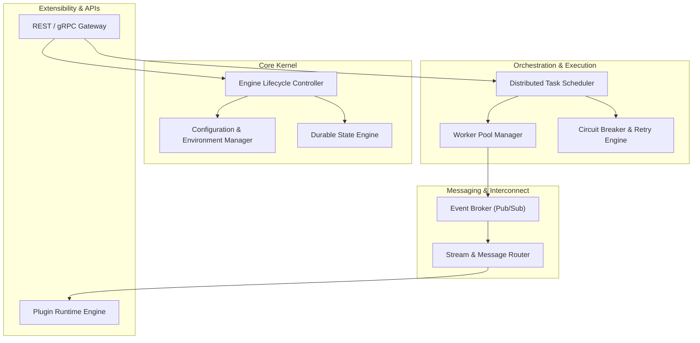

# brocode-core

[](LICENSE)
[](https://github.com/ER-brocode/brocode-core/discussions)
[](#)

> The foundational runtime engine, distributed orchestration kernel, and core primitives for the **ER.brocode** ecosystem.

---

## 📖 Overview & Mission

**`brocode-core`** provides the heartbeat of ER.brocode applications. It is engineered from the ground up to solve complex distributed task orchestration, asynchronous event propagation, and automated self-healing workflows with unmatched resilience and performance.

### Key Objectives
- **Fault-Tolerant Execution**: Built-in circuit breakers, jittered exponential backoffs, and durable state checkpoints.
- **Modular & Extensible**: Pluggable architecture allowing custom runtime adapters, transports, and telemetry providers.
- **Type-Safe & Developer-Centric**: Strict contracts, deterministic event streams, and ergonomic API abstractions.

---

## 🏗️ Architecture

`brocode-core` is architected into layered, loosely-coupled subsystems:



### Module Breakdown
- **`src/kernel/`**: Lifecycle bootstrapper, process signal handling, and core runtime state.
- **`src/orchestration/`**: Task scheduling, DAG execution pipelines, and concurrency controls.
- **`src/resilience/`**: Circuit breakers, health watchdogs, and fault recovery primitives.
- **`src/events/`**: Asynchronous message dispatching and typed event buses.
- **`src/plugins/`**: Extensible plugin hooks, custom middleware, and execution adapters.

---

## 🚀 Getting Started

### Prerequisites
- Node.js >= 20.x or Python >= 3.11 / Go >= 1.22 (depending on chosen subsystem runtime)
- Git 2.30+

### Installation & Local Setup

```bash
# Clone the repository
git clone https://github.com/ER-brocode/brocode-core.git
cd brocode-core

# Verify environment setup
git status
```

### Development Scripts & Workflow
```bash
# Run test suite
npm test # or make test / pytest

# Check code formatting & linting
npm run lint

# Build release artifacts
npm run build
```

---

## 🛡️ Team Guidelines & Best Practices

1. **Test-Driven Rigor**: All PRs must include unit tests for business logic and integration tests for external communication boundaries.
2. **Resilience First**: Any external I/O or network call must employ timeout bounds, circuit breaker protection, and safe fallback strategies.
3. **Semantic Versioning**: We adhere strictly to [SemVer 2.0.0](https://semver.org/).
4. **Code Reviews**: Every contribution requires review and sign-off by team maintainers.

---

## 💬 Discussions & Support

Community discussions and RFCs for `brocode-core` happen right here on GitHub:
- [brocode-core Discussions](https://github.com/ER-brocode/brocode-core/discussions)
- Report issues and feature requests via [GitHub Issues](https://github.com/ER-brocode/brocode-core/issues).

---

## 📜 License
This project is licensed under the [MIT License](LICENSE).
